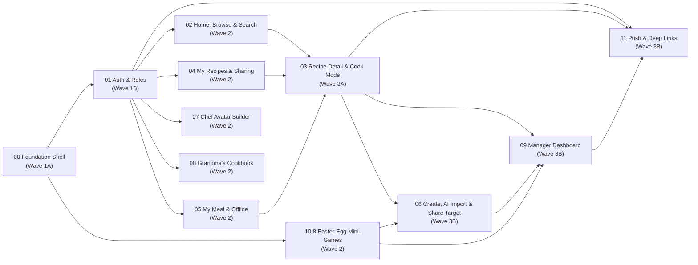

# L2 Pyramid Summary — Vertical Slice Dependency DAG & Worktree Ownership

> Guides the Factory Orchestrator (`factory/orchestrator/`) when scheduling Waves 1–3 across parallel Git worktrees on `native-mobile` without merge conflicts or circular dependencies.

## 1. Execution Waves & Slice Dependency Graph

_Why this DAG is strictly acyclic and conflict-free:_

- **Wave 1B (`S01`)** exposes a clean optional `registerBeforeSignOutHook(fn)` callback so **Wave 3B (`S11`)** registers `NotificationService.unregisterCurrentDevice` on startup without creating a backward import dependency.
- **Wave 2 (`S02`, `S04`, `S05`, `S07`, `S08`, `S10`)** run 100% in parallel:
  - `S02` owns `recipe-service.ts` (read/list), `recipe-image-service.ts`, `recipe-search-service.ts`, and `favorites-service.ts`.
  - `S10` owns `app/games.tsx`, `src/games-host/*` (including `GameHostModal` filler games), and `scripts/bundle-mobile-games.mjs` so **Wave 3B (`S06` AI Import & `S09` AI Image Enhancer)** both import `GameHostModal` cleanly!
- **Wave 3A (`S03` Recipe Detail)** runs once `S02`, `S04`, and `S05` are merged so it directly imports `RecipeImageService`, `FavoritesService`, `RecipeShareService`, `RecipeSubmissionService`, and `ActiveMealService`, exposing clean optional extension slots/callbacks for `הצע עריכה` (wired when `S06`/`S09` merge in Wave 3B).

## 2. File Ownership Boundaries (Zero Worktree Conflicts)

|  Wave  | Slice | Spec File                                           | Owned Paths under `apps/mobile/`                                                                                                                                                                                                                                                |
| :----: | ----- | --------------------------------------------------- | ------------------------------------------------------------------------------------------------------------------------------------------------------------------------------------------------------------------------------------------------------------------------------- |
| **1A** | `00`  | `factory/specs/00-foundation-shell.md`              | `app.config.ts`, `app/_layout.tsx`, `app/(tabs)/_layout.tsx`, `src/theme/*`, `src/services/_firebase/*`, `src/services/logger.ts`, `src/components/ui/*`                                                                                                                        |
| **1B** | `01`  | `factory/specs/01-auth-and-roles.md`                | `app/auth.tsx`, `src/services/auth/*`, `src/services/users/user-service.ts`, `src/components/auth/*` (except `avatar-builder`)                                                                                                                                                  |
| **2**  | `02`  | `factory/specs/02-home-browse-search.md`            | `app/(tabs)/home.tsx`, `app/(tabs)/categories.tsx`, `src/services/recipes/recipe-service.ts` (read/list), `src/services/recipes/recipe-image-service.ts`, `src/services/recipes/recipe-search-service.ts`, `src/services/users/favorites-service.ts`, `src/components/browse/*` |
| **2**  | `04`  | `factory/specs/04-my-recipes-and-sharing.md`        | `app/(tabs)/my-recipes.tsx`, `src/services/recipes/recipe-share-service.ts`, `src/services/recipes/recipe-submission-service.ts`, `src/components/library/*`                                                                                                                    |
| **2**  | `05`  | `factory/specs/05-my-meal-and-offline.md`           | `app/(tabs)/my-meal.tsx`, `src/services/meals/active-meal-service.ts`, `src/components/meal/*`                                                                                                                                                                                  |
| **2**  | `07`  | `factory/specs/07-chef-avatar-builder.md`           | `src/components/auth/avatar-builder/*`                                                                                                                                                                                                                                          |
| **2**  | `08`  | `factory/specs/08-grandmas-cookbook.md`             | `app/(tabs)/grandmas-cooking.tsx`, `src/services/pdf/pdf-service.ts`, `src/components/grandma/*`                                                                                                                                                                                |
| **2**  | `10`  | `factory/specs/10-easter-egg-mini-games.md`         | `app/games.tsx`, `src/games-host/*`, `scripts/bundle-mobile-games.mjs`                                                                                                                                                                                                          |
| **3A** | `03`  | `factory/specs/03-recipe-detail-cook-mode.md`       | `app/recipe/[id].tsx`, `src/services/recipes/media-instruction-service.ts`, `src/components/recipe-detail/*`                                                                                                                                                                    |
| **3B** | `06`  | `factory/specs/06-create-ai-import-share-target.md` | `app/(tabs)/propose-recipe.tsx`, `src/services/recipes/recipe-import-service.ts`, `src/services/recipes/recipe-edit-suggestion-service.ts`, `src/components/recipe-form/*`, `src/hooks/useShareIntent.ts`                                                                       |
| **3B** | `09`  | `factory/specs/09-manager-dashboard.md`             | `app/(tabs)/dashboard.tsx`, `src/services/recipes/ai-enhancement-service.ts`, `src/services/admin/*`, `src/components/dashboard/*`                                                                                                                                              |
| **3B** | `11`  | `factory/specs/11-push-and-deep-links.md`           | `src/services/users/notification-service.ts`, `src/hooks/usePushNotifications.ts`, `src/hooks/useDeepLinks.ts`                                                                                                                                                                  |

## 3. Visible Inner Gate (Must Pass Before AI-to-AI Review)

Every slice worktree MUST pass all visible checks before submitting to the AI-to-AI Reviewer:

1. `npm --prefix apps/mobile run typecheck` (`tsc --noEmit` — 0 errors)
2. `npm run lint` & `npm --prefix functions run lint` (0 errors, incl. two-tier Firebase, RTL logical props, zero raw hex rules)
3. `npm run check:tokens` & `node scripts/sync-shared.mjs --check`
4. `npm test` (web + shared unit tests + mobile RNTL unit tests)
5. `npm run test:rules` & `npm run test:functions` (when backend/shared untouched, confirms 0 regressions)
6. `npm run build` (web SPA production build remains 100% green)
7. `npm run mobile:build:android && npm run mobile:smoke:android` (local WSL2 Android Emulator smoke against DTU)
